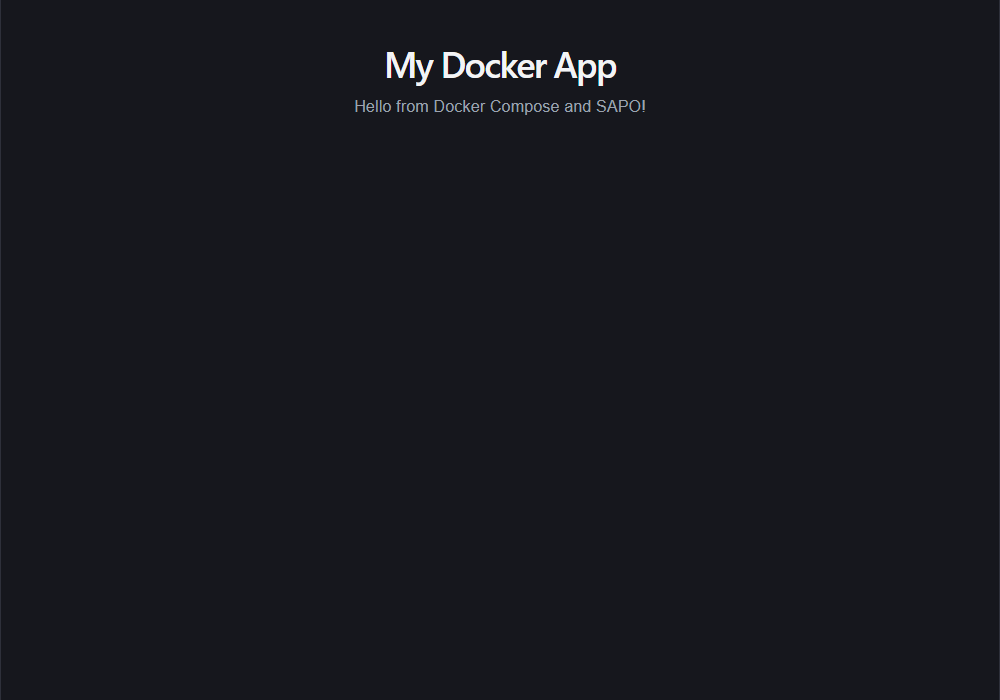

# My Docker App

A small full-stack web application that demonstrates containerization with Docker, Docker Compose, and PostgreSQL.

The app has a **React (Vite) frontend** served by **Nginx**, a **.NET 10 Web API**, and a **PostgreSQL 16** database. All three services run in containers and are started together with Docker Compose.



## Features

- React frontend that shows a message loaded from the API.
- .NET 10 minimal Web API with a single `GET /api/message` endpoint.
- Configurable message through an environment variable (`.env`).
- Multi-stage Dockerfiles for both the API and the frontend.
- Private Compose network: the web container reaches the API and database by service name.
- PostgreSQL data stored in a named Docker volume (`db-data`) so it survives container removal.
- No Node.js or .NET SDK required on the host to run the containers.

## Tech stack

| Layer | Technology | Container image |
| --- | --- | --- |
| Frontend | React 19 + Vite 8 | `node:22-alpine` (build), `nginx:alpine` (runtime) |
| Backend | .NET 10 Web API | `mcr.microsoft.com/dotnet/sdk:10.0` (build), `mcr.microsoft.com/dotnet/aspnet:10.0` (runtime) |
| Database | PostgreSQL 16 | `postgres:16-alpine` |
| Orchestration | Docker Compose | - |

## Quick start

### Requirements

- Docker Desktop (with Docker Compose v2)
- About 2 GB of free disk space for the images
- Ports `3000` and `5000` free on your computer

### Run the app

```bash
cd myapp
docker compose up --build
```

Open:

- App: <http://localhost:3000>
- API: <http://localhost:5000/api/message>

The page shows **My Docker App** and the message from the API.

To run in the background:

```bash
docker compose up -d --build
docker compose ps
```

### Stop the app

```bash
docker compose down
```

To also delete the database volume and all stored data:

```bash
docker compose down -v
```

## Configuration

Create or edit `.env` in the project root (same folder as `docker-compose.yml`):

```dotenv
APP_MESSAGE=Hello from Docker Compose!
DB_PASSWORD=change_me_123
```

| Variable | Used by | Description |
| --- | --- | --- |
| `APP_MESSAGE` | `api` | Text returned by `/api/message` |
| `DB_PASSWORD` | `db` | Password for the PostgreSQL `postgres` user |

After changing `APP_MESSAGE`, apply it with:

```bash
docker compose up -d
```

> `VITE_API_URL` is a **build-time** value. It is passed as a build argument in `docker-compose.yml` and defaults to `http://localhost:5000`. Changing it requires rebuilding the web image.

## Project structure

```text
myapp/
  api/                  .NET 10 Web API
    Program.cs          API code (endpoint + CORS)
    Dockerfile          multi-stage build
    .dockerignore
  web/                  React + Vite frontend
    src/App.jsx         UI that calls the API
    Dockerfile          build with Node, serve with Nginx
    .dockerignore
  docs/
    screenshot.png      app screenshot used in this README
  docker-compose.yml    api, web, and db services
  .env                  environment values (do not commit real secrets)
  README.md             this file
  documentation.md      full technical documentation
```

## Common commands

| Command | What it does |
| --- | --- |
| `docker compose up -d --build` | Build images and start all services |
| `docker compose ps` | List running services |
| `docker compose logs -f api` | Follow the API logs |
| `docker compose exec web ping -c 2 api` | Test service-name networking |
| `docker compose exec db psql -U postgres -d appdb` | Open the database shell |
| `docker compose down` | Stop and remove containers (keeps data) |
| `docker compose down -v` | Stop and remove containers and the data volume |
| `docker compose down -v --rmi local` | Also remove the images built by Compose |

## How it works

1. `docker compose up --build` builds `api` and `web` from their Dockerfiles.
2. Compose creates the `myapp_default` network and the `myapp_db-data` volume.
3. Nginx serves the compiled React files on port `3000`.
4. The browser calls the API at `http://localhost:5000/api/message`.
5. The API reads `Message` from its environment (`APP_MESSAGE`) and returns JSON.
6. PostgreSQL is reachable only from inside the Compose network, using the host name `db`.

## Security notes

- `.env` is listed in `.gitignore`. Never commit real passwords.
- The database port is intentionally not published to the host.
- This project is for learning. Use a secret manager and HTTPS in production.

## Documentation

See [documentation.md](documentation.md) for the architecture, Dockerfile walkthrough, API reference, verification results, and troubleshooting.
